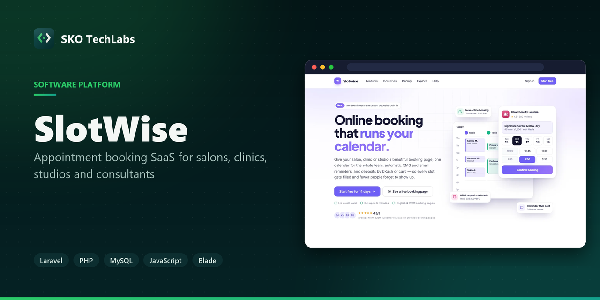
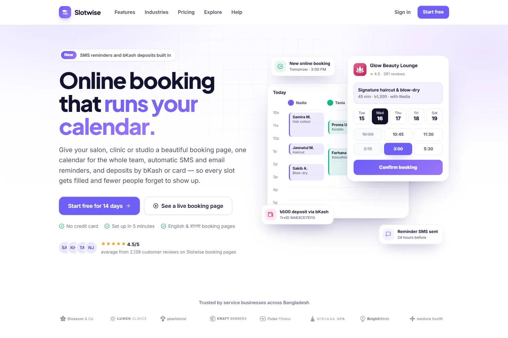
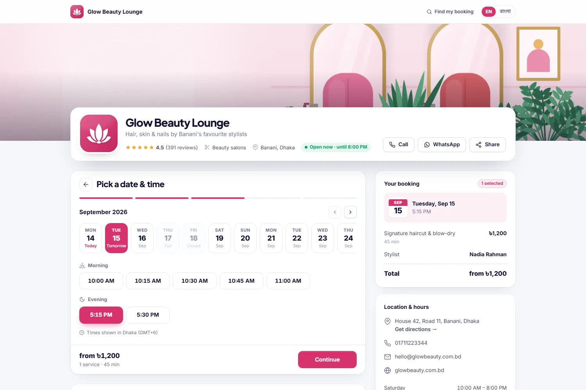
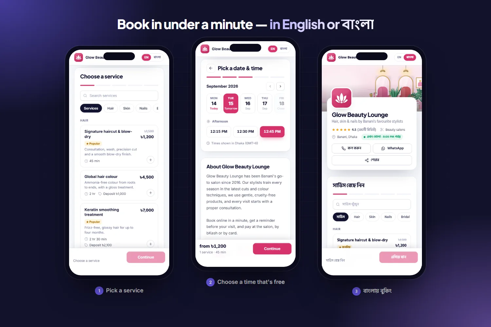
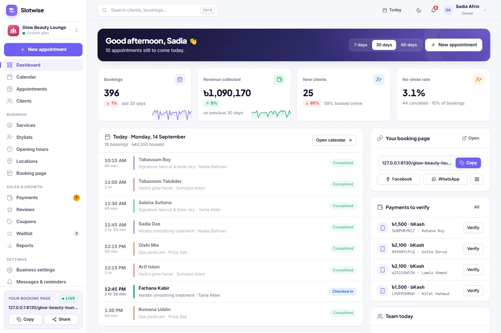
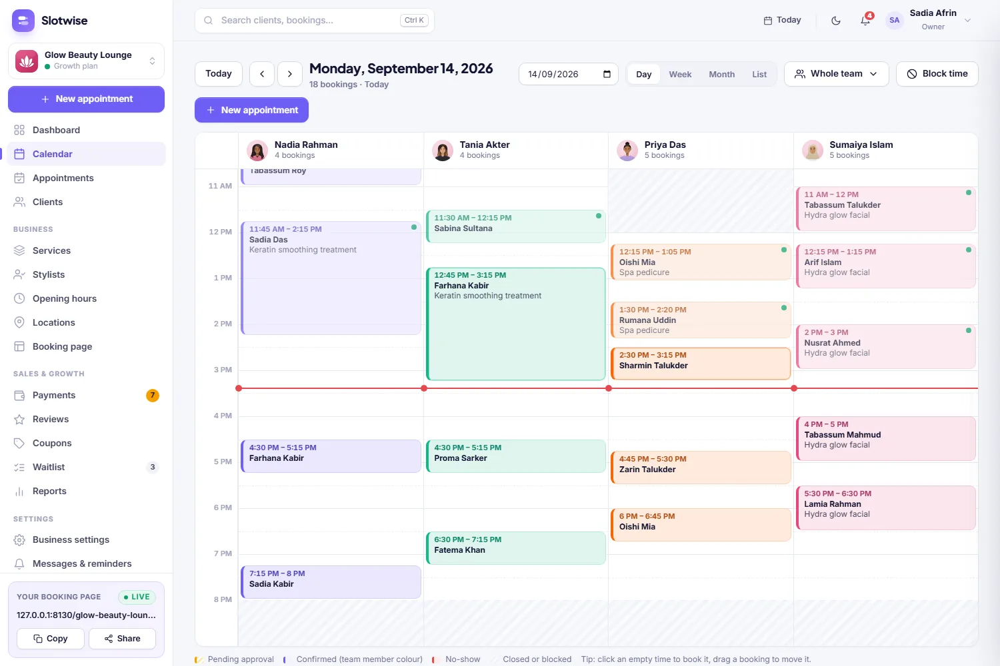
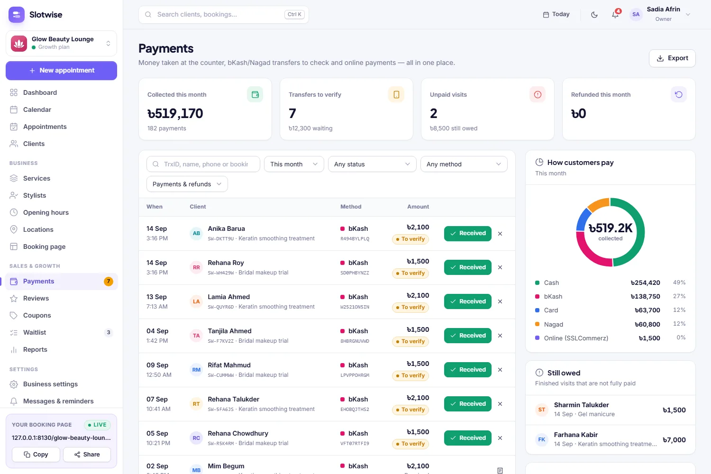
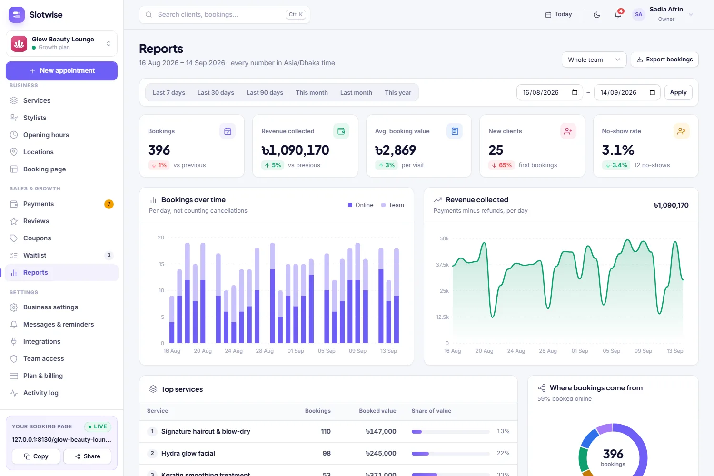
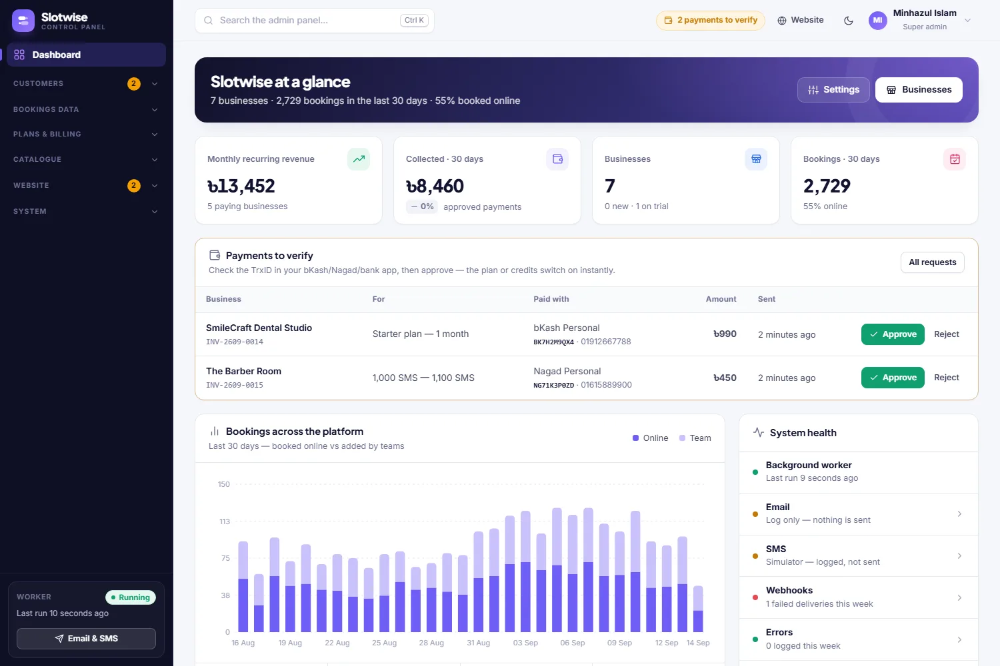

<h3>Appointment booking SaaS for salons, clinics, studios and consultants</h3>

A multi-business booking SaaS for salons, clinics, studios and consultants — a beautiful booking page in English and বাংলা, a team calendar, SMS and email reminders, bKash and card deposits, and an admin panel that manages the whole platform.

   

<a href="https://slotwise.skotechlabs.com"><b>Live Demo</b></a> &nbsp;·&nbsp; <a href="https://skotechlabs.com/projects/slotwise-online-appointment-booking-platform"><b>Case Study</b></a> &nbsp;·&nbsp; <a href="https://skotechlabs.com/contact"><b>Request a Demo</b></a> &nbsp;·&nbsp; <a href="https://github.com/skotechlabs"><b>All Products</b></a>

---

## Overview

Slotwise gives every service business its own online booking page. Customers pick a service, a team member and a time that is genuinely free, pay a deposit by bKash, Nagad or card if one is needed, and get a confirmation and reminders by SMS and email — in English or বাংলা, without downloading an app or creating an account.

Behind the page, each business runs its day from one console: a drag-and-drop team calendar, appointments and customer history, payments with transaction-ID verification, reviews, a waitlist that fills cancelled slots, reports and role-based access for owners, front desk and team members. The platform owner manages plans and billing approvals, industry templates, message templates and every word on the marketing website from a super admin panel.

<table>
<tr>
<td width="50%" valign="top">

### The Challenge

Most salons, doctors' chambers and studios in Bangladesh still take bookings over the phone and in a notebook: staff lose hours answering calls, the same slot gets promised twice, customers forget and never show up, and advance payments by bKash are checked by scrolling through message history. International booking tools rarely fit local habits — mobile banking deposits, Bangla pages, SMS gateways and weeks that start on Saturday.

</td>
<td width="50%" valign="top">

### Our Solution

We built a multi-tenant platform where one booking engine serves every channel — the public page, the website widget and the console. It computes free times in each business's own timezone, locks team members while a booking is saved so a slot can't be taken twice, and fans every change out to messages, the calendar, webhooks and the waitlist. Payments recompute the balance from a ledger, SMS use prepaid credits, and each business starts from an industry template with services, hours and wording that already fit.

</td>
</tr>
</table>

## Key Features

- Booking page for every business with its own address, QR code, website widget and English / বাংলা switch
- Real-time availability from opening hours, breaks, time off, buffers and existing bookings — no double-booking
- Several services in one visit, "any available" team member, classes with seats and a waitlist for full days
- Drag-and-drop team calendar with day, week, month and list views, blocked time and walk-ins
- Deposits and payments by bKash, Nagad, Rocket (with transaction-ID verification) and SSLCommerz
- Automatic SMS and email confirmations, reminders and review requests with editable templates
- Customer profiles with visit history, no-shows, notes, tags and CSV import/export
- Reports: revenue, bookings by source, busiest hours heatmap, team utilisation, new vs returning customers
- Team access with owner, manager, front desk and team-member roles; calendar feeds and signed webhooks
- Super admin panel: plans and limits, billing approvals, SMS credits, industry templates, website CMS and help centre

## Business Impact

- Customers book 24/7 in under a minute from Facebook, Instagram, Google or the business's website
- The calendar only offers times that are really free, so double-bookings disappear
- Two automatic reminders per visit and upfront deposits cut no-shows
- bKash and Nagad transfers are verified in one click instead of scrolling through messages
- Owners see revenue, busy hours and team utilisation without spreadsheets

## Screenshots

<table>
<tr>
<td width="50%" valign="top"> Marketing website with pricing, industries and a help centre — all managed from the admin panel</td>
<td width="50%" valign="top"> Booking page: pick a service, a team member and a time that is really free</td>
</tr>
<tr>
<td width="50%" valign="top"> Mobile booking flow in English and বাংলা</td>
<td width="50%" valign="top"> Business dashboard with today's appointments, revenue and payments to verify</td>
</tr>
<tr>
<td width="50%" valign="top"> Team calendar with every staff member side by side, drag to reschedule</td>
<td width="50%" valign="top"> Payments with bKash / Nagad transaction-ID verification, refunds and receipts</td>
</tr>
<tr>
<td width="50%" valign="top"> Reports: revenue, sources, team utilisation and busiest hours</td>
<td width="50%" valign="top"> Super admin panel: platform revenue, billing approvals and system health</td>
</tr>
</table>

> See it running: **[slotwise.skotechlabs.com](https://slotwise.skotechlabs.com)**

## Technology Stack

## Source Code & Licensing

This repository is the public showcase for **SlotWise**. The production source code is proprietary and is maintained privately by SKO TechLabs.

Interested in this product for your business? We offer:

- **Ready-to-launch deployment** of SlotWise under your own brand and domain
- **Customisation** of features, workflows, languages and integrations to fit how you work
- **Custom development** of a new product built on the same foundations
- **Ongoing support**, hosting, maintenance and feature roll-outs after launch

## Get in Touch

---

© 2026 <a href="https://skotechlabs.com">SKO TechLabs</a> · Dhaka, Bangladesh · Building intelligent digital solutions

